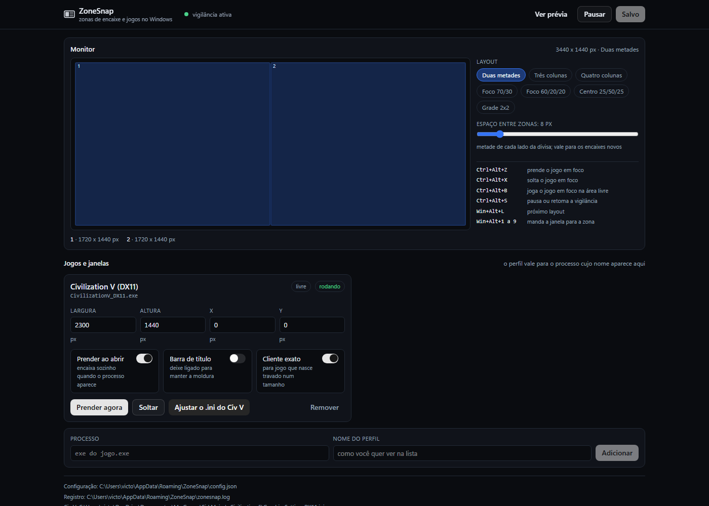

# ZoneSnap

Zonas de encaixe e encaixe de jogos para o Windows, num executável único em Rust,
sem instalador, sem admin e com configuração em JSON legível.

Nasceu de um problema concreto: num ultrawide 3440 x 1440, o Easy Setting Box
parou de mostrar a barra de zonas ao arrastar a janela, e o FancyZones do
PowerToys não fazia o que faltava, que era prender um jogo num tamanho fixo e
manter o resto da tela livre. O ZoneSnap faz as duas coisas: zonas fracionárias
por layout e perfis por processo, com vigilância que reencaixa sozinha.



## O que ele faz

- **Zonas por layout**: sete layouts prontos pensados para 3440 x 1440, com
  frações de 0 a 1 da área útil do monitor. Você troca de layout pelo menu do
  ícone, pela interface ou por atalho.
- **Prévia ao arrastar**: enquanto você arrasta uma janela, o ZoneSnap desenha as
  zonas sobre a tela e destaca a zona sob o cursor. É a barra que o Easy Setting
  Box mostrava, só que desenhada pelo próprio programa.
- **Prévia avulsa**: `zonesnap.exe --preview` (ou `--preview --seconds 6`) mostra
  as zonas sem precisar arrastar nada.
- **Encaixe por atalho**: `Win+Alt+1` a `Win+Alt+9` manda a janela em foco para a
  zona daquele número.
- **Perfis de jogo**: um perfil por processo fixa tamanho, posição e moldura.
  Com vigilância ligada, o ZoneSnap reencaixa a janela quando ela foge (o jogo
  redimensiona ao entrar em uma partida, por exemplo) sem tocar no que você
  estiver fazendo.
- **Caso Civilization V**: modo em que o encaixe é feito pelo cliente da janela,
  com o tamanho nascendo certo no arquivo `.ini` do jogo, mais um comando que
  regrava esse `.ini` com backup. Explicado abaixo.
- **Interface local**: uma página servida em `127.0.0.1` mostra o mapa do
  monitor, os perfis e o estado, e salva a configuração no arquivo.
- **Sem telemetria**: o programa não faz nenhuma conexão de saída. A interface
  é servida na própria máquina, com token.

## Como usar

1. Baixe `zonesnap.exe` (ou compile, veja o fim deste arquivo).
2. Rode. Ele fica no ícone ao lado do relógio.
3. Clique no ícone para abrir o menu (clique esquerdo também abre).
4. Arraste a janela para uma zona e ela encaixa; `Win+Alt+1` a `9` encaixa
   direto.

Não precisa instalar, não pede administrador e não escreve nada fora de
`%APPDATA%\ZoneSnap` e da pasta que você mandar ele abrir.

## Menu do ícone

| Item | O que faz |
|---|---|
| Desligar zonas / religar | liga e desliga o encaixe ao arrastar |
| Layout | escolhe entre os layouts configurados |
| Abrir interface | abre a página de configuração no navegador |
| Jogos | prender ou soltar cada perfil, pausar a vigilância, soltar todas as janelas presas |
| Abrir config.json | abre a configuração no editor padrão |
| Recarregar config | relê o arquivo sem reiniciar |
| Sair | fecha o programa e solta as janelas presas |

## Atalhos

Os atalhos valem com a janela que você quer encaixar em foco.

| Atalho | O que faz |
|---|---|
| `Win+Alt+L` | próximo layout |
| `Win+Alt+1` a `9` | manda a janela em foco para a zona N |
| `Ctrl+Alt+Z` | prende o jogo em foco (usa o perfil do processo) |
| `Ctrl+Alt+X` | solta o jogo em foco e devolve a janela ao estado anterior |
| `Ctrl+Alt+B` | manda o jogo em foco para a área livre, à direita da faixa |
| `Ctrl+Alt+S` | pausa ou retoma a vigilância |

Se outro programa já tomou um atalho `Ctrl+Alt+*`, o ZoneSnap registra a versão
com `Shift` e escreve no registro qual foi usada (`Ctrl+Alt+Z ocupada; usei
Ctrl+Alt+Shift+Z`). O log fica em `%APPDATA%\ZoneSnap\zonesnap.log`.

## Interface

`zonesnap.exe --ui` abre a interface no navegador padrão, já com o token no
endereço. Se o programa já estiver rodando, esse comando só abre a janela do
navegador apontando para a instância existente.

A página mostra:

- o mapa do monitor em escala, com as zonas do layout atual e o tamanho em
  pixels de cada uma;
- os layouts e o espaço entre zonas (a fresta é dividida meio a meio na divisa);
- um cartão por perfil de jogo, com tamanho, posição, os três interruptores,
  `Prender agora`, `Soltar` e `Ajustar o .ini do Civ V`;
- os caminhos da configuração, do registro e do `.ini` do Civilization V.

A interface conversa com um servidor HTTP preso em `127.0.0.1`, numa porta entre
47121 e 47160, e exige o cabeçalho `X-ZoneSnap` com o token que está em
`%APPDATA%\ZoneSnap\ui.token`. O token existe para impedir que outra página
aberta no navegador mexa na sua configuração; ele não protege contra outro
programa rodando na mesma conta de usuário, que pode ler o arquivo. Se isso for
relevante para você, feche a interface quando não estiver usando.

## Configuração

O arquivo é criado na primeira execução em `%APPDATA%\ZoneSnap\config.json`.
Editar com o programa aberto funciona: ele relê o arquivo a cada 2 segundos.

```json
{
  "layout": 0,
  "gap": 8,
  "show_overlay": true,
  "jogo_largura": 2300,
  "layouts": [
    {
      "name": "Duas metades",
      "zones": [[0.0, 0.0, 0.5, 1.0], [0.5, 0.0, 0.5, 1.0]]
    }
  ],
  "jogos": [
    {
      "processo": "CivilizationV_DX11.exe",
      "nome": "Civilization V (DX11)",
      "largura": 2300,
      "altura": 1440,
      "x": 0,
      "y": 0,
      "vigiar": true,
      "borda": false,
      "alinhar_cliente": true,
      "preparar": "civ5"
    }
  ]
}
```

- `zones`: cada zona é `[x, y, largura, altura]` em fração da área útil do
  monitor, de 0 a 1. `[0, 0, 0.5, 1]` é a metade esquerda inteira.
- `gap`: fresta em pixels entre zonas, dividida meio a meio na divisa.
- `layout`: índice do layout em uso.
- `jogo_largura`: largura padrão da faixa do jogo quando o perfil não define uma.
- `processo`: nome do executável, como aparece no Gerenciador de Tarefas.
- `vigiar`: reencaixa a janela quando ela sai do lugar.
- `borda`: mantém a moldura e a barra de título. Desligado, a janela fica sem
  moldura e ocupa a zona inteira.
- `alinhar_cliente`: encaixa pelo cliente da janela em vez de pelo retângulo
  total, e desiste se o cliente não couber exatamente. É o modo para jogo que
  mede o cursor contra o cliente do momento em que foi criado.
- `preparar`: receita de preparação. Hoje só `civ5`.

## Civilization V: por que ele precisa de um modo próprio

O Civilization V mede a posição do mouse contra a área de cliente que existia
quando a janela foi criada no Direct3D. Se você tira a moldura e redimensiona
depois, o jogo estica a imagem e os cliques passam a cair no lugar errado: o
mapa responde a um ponto deslocado do cursor. Isso não é bug do ZoneSnap nem do
AutoHotkey, é como o jogo foi escrito.

A receita que funciona tem três partes, e o ZoneSnap faz as três:

1. O jogo precisa **nascer** com o cliente do tamanho da zona. Para isso o
   `.ini` do jogo tem que estar com `FullScreen = 0`, `WindowResX = 2300` e
   `WindowResY = 1440` **antes** de abrir.
2. O perfil precisa estar com `alinhar_cliente: true` e `borda: false`. Nesse
   modo o ZoneSnap não mexe no estilo da janela, mede o cliente e confere se ele
   bate com a zona com tolerância de 1 pixel. Se não bater, ele desfaz e avisa:
   `cliente ficou em 2347x1440 e a zona pede 2300x1440; rode --preparar-civ e
   abra o jogo de novo`.
3. O `.ini` só pode ser gravado com o jogo fechado, porque o jogo lê esse
   arquivo ao abrir e o regrava ao sair. O comando abaixo recusa rodar com o
   jogo aberto e guarda uma cópia com data antes de escrever:

```
zonesnap.exe --preparar-civ
```

Fluxo completo, do zero:

1. Feche o Civilization V.
2. Rode `zonesnap.exe --preparar-civ`.
3. Abra o jogo pelo Steam, em DirectX 11.
4. Com o jogo aberto, `Ctrl+Alt+Z` (ou o botão `Prender agora` na interface).

Se você mudar a largura da faixa no perfil, rode o passo 2 de novo: o `.ini`
precisa combinar com o perfil, senão o encaixe é recusado de propósito, para não
esticar a imagem.

## Iniciar com o Windows

`Win+R`, digite `shell:startup` e ponha um atalho para `zonesnap.exe` na pasta
que abrir. Não precisa de tarefa agendada nem de administrador.

## Onde ficam os arquivos

| O que | Onde |
|---|---|
| Configuração | `%APPDATA%\ZoneSnap\config.json` |
| Registro | `%APPDATA%\ZoneSnap\zonesnap.log` |
| Token e porta da interface | `%APPDATA%\ZoneSnap\ui.token`, `ui.port` |
| `.ini` do Civ V | `Documents\My Games\Sid Meier's Civilization 5\GraphicsSettingsDX11.ini` |

A pasta de documentos é resolvida pelo Windows, então funciona com OneDrive e com
o nome traduzido (`Documentos`).

## Limites conhecidos

- Só Windows 10 e 11, x64. Usa API do Windows direto, sem camada de
  compatibilidade.
- Uma instância por vez, garantida por mutex.
- Monitor virtual de streaming (Sunshine, Moonlight, VDD) é ignorado de
  propósito: encaixar janela num monitor que não existe fisicamente faz o jogo
  sumir da tela.
- Janela de jogo que ignora `SetWindowPos` não tem como ser encaixada. O
  ZoneSnap tenta três vezes, desiste e escreve o motivo no log.
- Jogos em tela cheia exclusiva não são afetados: eles não são janelas comuns.
  Use janela sem borda.
- Os atalhos são globais. Se outro programa já usa a combinação, o ZoneSnap cai
  para a variante com `Shift`; se as duas estiverem ocupadas, ele avisa no log e
  segue sem aquele atalho.
- A interface é uma página só, embutida no executável. Não tem autenticação de
  usuário, só o token local descrito acima.

## Comparação com o PowerToys FancyZones

| | ZoneSnap | FancyZones |
|---|---|---|
| Zonas por layout | sim, em JSON | sim, no editor |
| Encaixe por atalho numerado | sim | sim |
| Prender jogo num tamanho fixo com vigilância | sim | não |
| Encaixe pelo cliente da janela (Civ V) | sim | não |
| Regravar o `.ini` do jogo | sim | não |
| Instalação | nenhuma, um `.exe` | instalador do PowerToys |
| Customização do código | Rust, MIT | C++, MIT |

## Recompilar

Precisa de Rust estável e Node 20 ou mais novo.

```
cd ui
pnpm install
pnpm build
cd ..
cargo build --release
```

O `cargo` embute `ui/dist/index.html` no executável com `include_str!`, então a
interface precisa ser gerada antes. Se o `cargo` reclamar que não achou
`../ui/dist/index.html`, é isso que faltou.

O resultado é `target\release\zonesnap.exe`, um arquivo só, de cerca de 1 MB.

## Licença

MIT. Os componentes de interface vieram do [shadcn/ui](https://github.com/shadcn-ui/ui),
também MIT, e mantêm o aviso de copyright nos arquivos.
